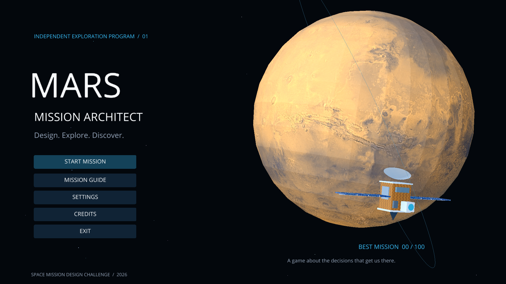
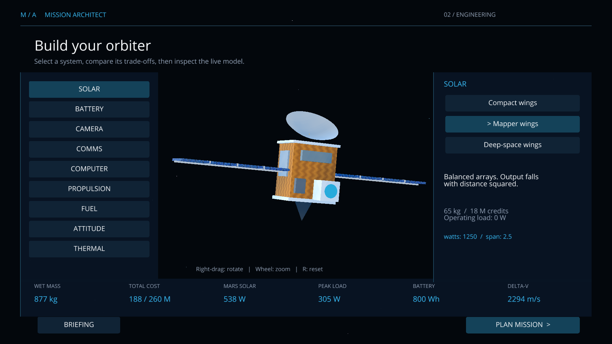

# MARS: Mission Architect

**Design. Explore. Discover.** A playable 3D mission-engineering game in Python and Ursina.

Build a robotic orbiter, choose a launcher and Mars orbit, watch the journey, map five scientifically interesting regions, and return their images before the operations deadline. A stronger camera is only useful if you can power it, store its images and downlink them.

Independent Space Mission Design Challenge project. Not an official NASA product or endorsement.




## Play on Windows 11

1. Extract **the entire ZIP** into a normal folder, such as `Documents\Mars-Mission-Architect`.
2. Install/use **64-bit Python 3.12** with the `py` launcher.
3. Double-click **START_GAME.bat**. On the first run it creates `.venv` and installs the pinned dependencies. Internet is needed for this installation only.
4. Choose **Start Mission**. Keep the default spacecraft for your first flight.

If using VS Code's terminal instead:

```powershell
py -3.12 -m venv .venv
.\.venv\Scripts\python.exe -m pip install -r requirements.txt
.\.venv\Scripts\python.exe main.py
```

The entry point is lowercase **main.py**. Windows treats filename case equivalently; do not add a separate `Main.py`. No API keys, online service, paid tools or downloaded runtime assets are required after installation.

Default window: 1920×1080; tested rendering: 1280×720, 1920×1080 and 1024×768. Resize the window, use F11, or run `python main.py --size=1280x720`. A 16:9 display is recommended; narrower layouts are scaled down to keep controls visible. Hardware FPS has not been benchmarked.

## How to win

- Launch using the balanced default: **Aster 2 / Hohmann window / Low mapping**.
- Read the readiness checks. Hard budget, mass or departure-energy blockers require changes; fuel and power warnings let you run a failure experiment.
- After Mars capture, select a region and arm **CAMERA**. It waits for a clear, sunlit observation window.
- Enable **DOWNLINK** early. It waits for Earth visibility and drains stored data.
- When a region reaches **80%**, select the next region and arm the camera again.
- A deterministic dust event affects Jezero and Eberswalde during operations hours 2–5. Work on another region while it passes.
- Reach **80% coverage in all five regions**, return **at least 80% of all collected data**, and retain positive health within **24 simulated operations hours**.

At normal speed, one real second represents one minute of orbital operations. The default test strategy completes in about 9.46 simulated hours, or about 9.5 minutes at 1x plus cinematics. Use 4x/12x for faster demonstrations and pause to make decisions. There is no landing or rover stage.

## Features

- Cinematic textured Mars menu, procedural starfield, original modular orbiter and Earth artwork.
- Nine component categories, each with three options, live engineering totals and visible solar/dish/camera/tank changes.
- Three fictional Mars-injection launchers, three transfer assumptions, three orbit choices and a transfer diagram.
- Launch, Earth departure, solar deployment, cruise, capture and interactive mapping phases.
- Power generation, eclipses, battery energy, thermal load, storage, communications windows, pointing and image sharpness affect results.
- Five real regions: Jezero, Gale, Eberswalde, Holden and Mawrth Vallis. Historical candidates and past landing regions are used as educational survey targets, not advertised as newly selected NASA sites.
- Original synthesized ambient music and effects; master/music/effects controls, mute and reduced motion.
- JSON saves, continue, results, replay, previous-run comparison and a field manual.

## Controls

| Input | Action |
| --- | --- |
| Right mouse drag | Rotate inspection camera |
| Mouse wheel | Zoom |
| R | Reset camera |
| 1 / 2 / 3 | Planet, close spacecraft, wide mission view |
| Space or Escape during flight | Pause/resume |
| I | Arm/disarm imaging after capture |
| T | Schedule/stop downlink after capture |
| F11 | Toggle fullscreen |
| Save & Menu | Save current mission and return to menu |
| End Mission | Confirm an early debrief |

Close spacecraft view follows the orbiter during mapping. The settings menu is accessible from the main menu. Saves are automatic every 15 active seconds and on mission transitions/menu actions. On Windows they live at `%LOCALAPPDATA%\MarsMissionArchitect\save.json`. Missing/corrupt saves are ignored safely. No saves are written into the source distribution.

## Science

NASA's Mars texture and physical constants are integrated alongside established formulas. Hardware choices and the operational model are deliberately simplified. Read [SCIENCE.md](docs/SCIENCE.md) for equations, units, assumptions, source links and asset provenance. Coverage and weather are game models, not predictions or live NASA data.

## Test and build

```powershell
.\.venv\Scripts\python.exe -m pip install pytest==9.2.0
.\.venv\Scripts\python.exe -m pytest -q
```

The Linux offscreen rendering and UI callback test is `python main.py --smoke`. It uses Panda3D EGL and a disposable save path; it is not a Windows hardware test. See [TEST_REPORT.md](docs/TEST_REPORT.md).

For an application folder, run **BUILD_WINDOWS.bat** on Windows. It runs the provided PyInstaller build script and creates `dist\MarsMissionArchitect\MarsMissionArchitect.exe`. Distribute the **whole folder**, including `_internal`. This build recipe is supplied but has **not been executed or validated on Windows**. Source execution is the tested delivery route. See [WINDOWS_BUILD.md](docs/WINDOWS_BUILD.md).

## Team integration

Repository: `johnnguyenphuc01-max/Space-Mission-Design-Game`. This package was prepared independently because authenticated access to the private repository was unavailable. No branch, commit or push was made there.

Pull your team's latest work, create a feature branch such as `feature/full-mars-game`, and compare the supplied files with existing files before copying. Preserve teammates' work. Do not copy `.venv`, save data, build output or test output. Run the tests and source application before opening a review. Assign separate modules to teammates; the rendering-independent rules in `systems/` are a useful collaboration boundary.

## Limits

This is a complete **playable first build**, not a flight-design tool or a finished commercial game. Orbital opportunities, coverage, temperatures, radio windows, mission clocks and dust are abstractions. The 3D trajectory scale is illustrative. Cruise is a compressed cinematic, not a resource-propagating trajectory simulation. There is no terrain reconstruction, actual camera image export, ephemeris optimization, voice acting, multiplayer or rover. Some finer hardware upgrades affect statistics more than appearance. UI transitions and particle effects are intentionally modest. No Windows `.exe`, actual sound-device playback or target-hardware frame rate has been verified in this environment.
